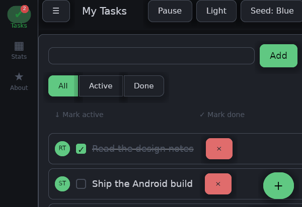
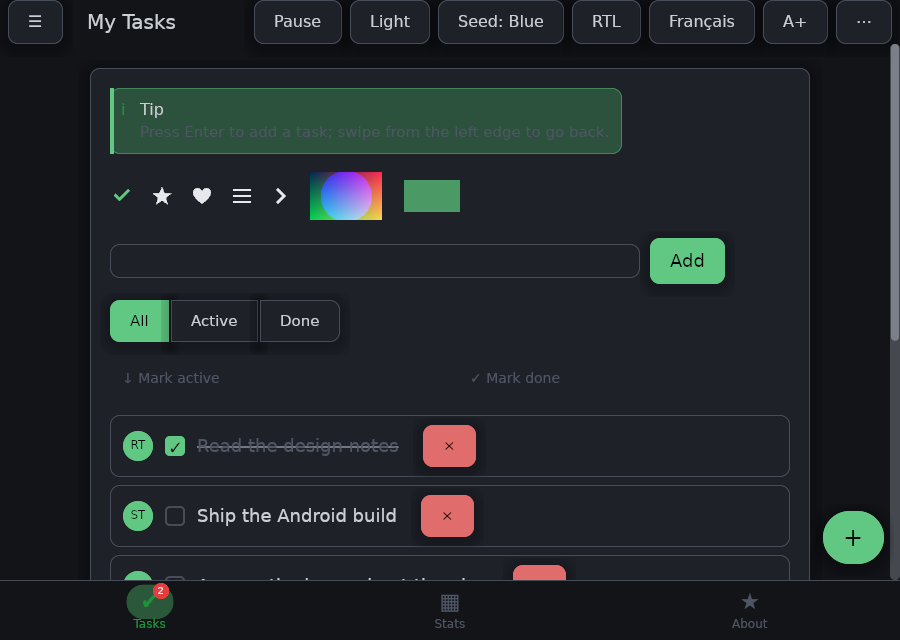
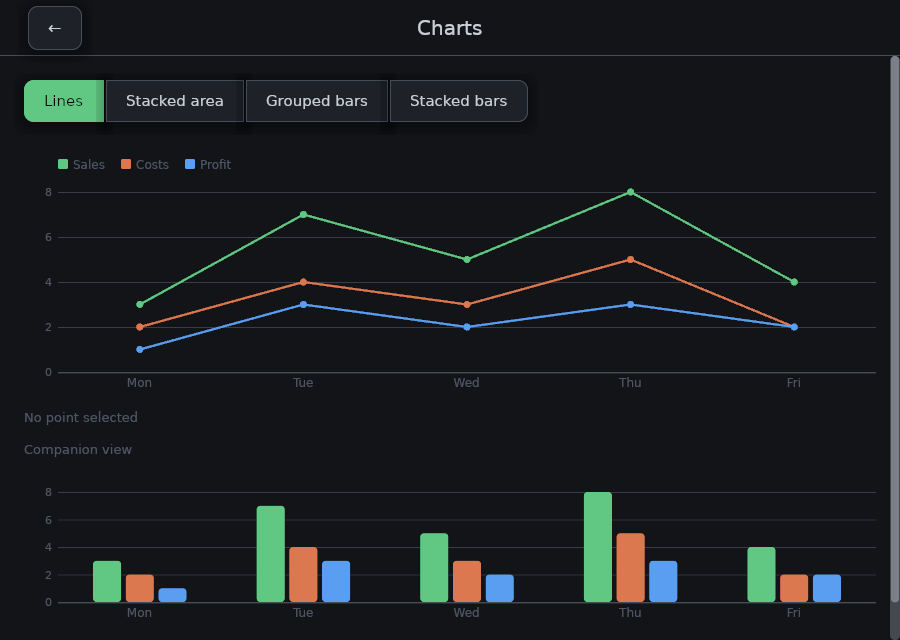
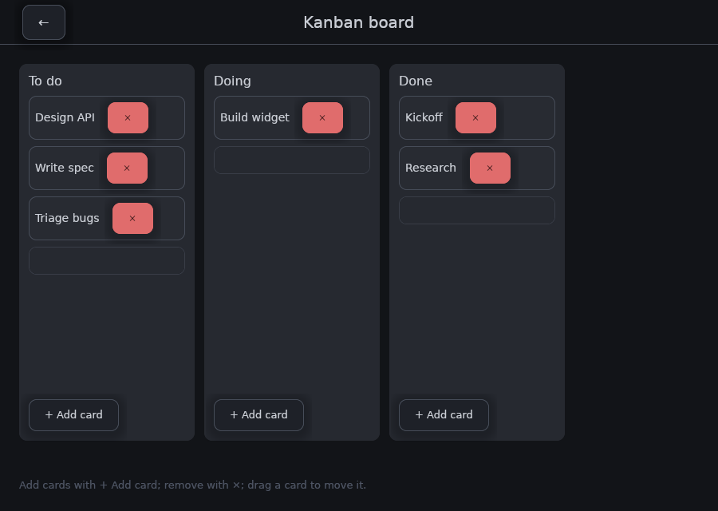
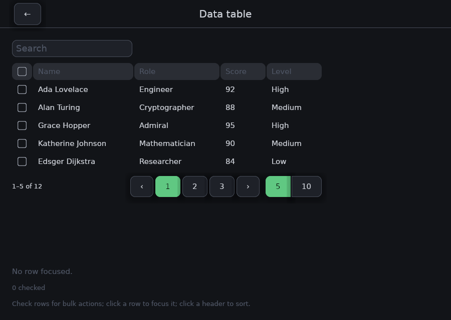
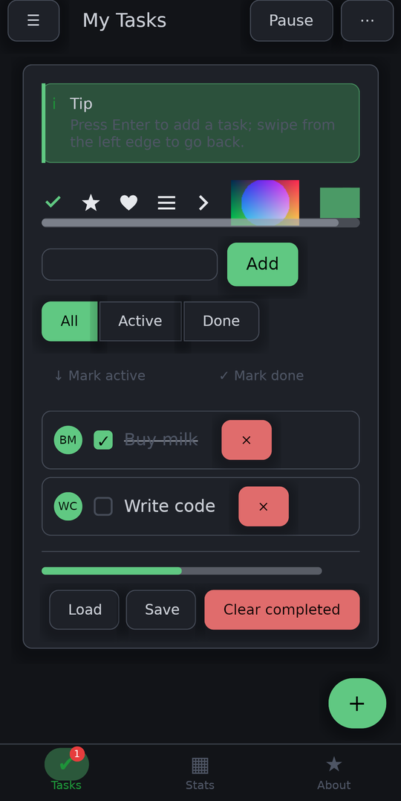
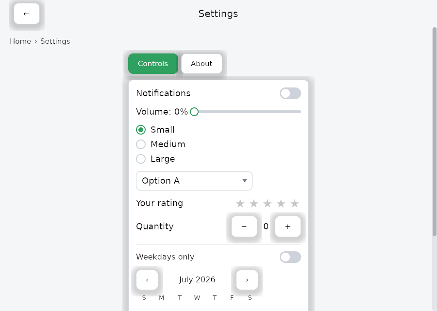

<div align="center">


# frus

**Un framework UI multiplateforme écrit entièrement en Rust.**

Un seul code → bureau, Android et le Web. Rendu GPU. Construit à partir de composants. Pas de DSL, pas de génération de code, pas de CLI maison — juste `cargo`.

[](https://github.com/KalybosPro/frus/actions/workflows/ci.yml)
[](#licence)
[](https://www.rust-lang.org)
[](#état-du-projet)

[Démarrer](#démarrer) · [Galerie](#à-quoi-ça-ressemble) · [Galerie de widgets en ligne](https://kalybospro.github.io/frus/) · [Architecture](#architecture) · [État](#état-du-projet) · [Contribuer](CONTRIBUTING.md) · [English](README.md)

<br>



<sub>L'application d'exemple passant d'un écran à l'autre. Chaque pixel — la mise en page, la typographie, les graphiques, les ressorts — est dessiné par frus sur le GPU.</sub>

</div>

---

## Qu'est-ce que frus ?

frus est une tentative *greenfield* de framework UI conçu en Rust dès le premier jour : **tout le framework — rendu, mise en page, widgets, gestes, thèmes, animations, accessibilité — est en Rust**. Aucune VM embarquée, aucun second langage pour la logique applicative, aucun canal de plateforme entre votre code et les pixels.

Les parties qui *doivent* être natives (création de fenêtre, IME, lecteurs d'écran, activité Android) vivent derrière une seule crate mince, `frus-shell`. Tout ce qui est au-dessus est portable.

```rust
use frus::{button, column, row, text, Align, BuildContext, FrusApp, Variant, Widget};

// Un widget est ce qu'il construit. Celui qui a quelque chose à retenir le garde avec un hook.
fn counter(cx: &BuildContext) -> Box<dyn Widget> {
    let count = cx.use_state(|| 0);
    let (up, down) = (count.clone(), count.clone());
    Box::new(column![
        text(format!("{}", count.get())).size(48.0),
        row![
            button("+", move || up.update(|n| *n += 1)).variant(Variant::Filled),
            button("−", move || down.update(|n| *n -= 1)).variant(Variant::Outlined),
        ].gap(20.0),
    ].gap(16.0).align(Align::Center))
}

// Une seule déclaration branche les points d'entrée bureau, Android et web.
frus::main!(FrusApp::from_fn(counter));
```

C'est une application complète et exécutable. `cargo run` sur le bureau, `cargo apk run` sur Android, `wasm-bindgen` pour le navigateur — le code ne change pas.

### Composants, état, contrôleurs, routes

Un widget sans rien à retenir est un `StatelessWidget` ; un widget qui garde quelque chose est un `StatefulWidget` dont le `State` survit aux reconstructions — avec `init_state`, `did_update_widget`, `dispose` et un `set_state` appelable depuis n'importe quel gestionnaire. Une simple fonction peut aussi garder un état, avec `use_state`, `use_ref`, `use_memo` et `use_effect`.

```rust
use frus::{button, column, BuildContext, GoRoute, GoRouter, FrusApp, TextField, Widget};

fn sign_in(cx: &BuildContext) -> Box<dyn Widget> {
    let email = cx.use_text_controller("");          // le texte du champ, tenu hors du champ
    let router = cx.router();
    Box::new(column![
        TextField::new("").label("Email").controller(&email),
        button("Continuer", move || router.go(format!("/welcome/{}", email.text()))),
    ])
}

let router = GoRouter::new(vec![
    GoRoute::new("/", |_, _| frus::component(sign_in)),
    GoRoute::new("/welcome/:name", |_, state| {
        frus::text(format!("Bonjour, {}", state.param("name").unwrap_or("vous")))
    }),
]);
frus::main!(FrusApp::router(router));
```

Le routeur garde une pile de pages, glisse de l'une à l'autre, répond au geste retour, suit les redirections et conserve l'état d'une page recouverte jusqu'à ce qu'elle soit retirée.

### Pourquoi un framework de plus ?

| | |
|---|---|
| **Un seul langage, de bout en bout** | Logique applicative, widgets, layout et moteur de rendu sont tous en Rust. Pas de frontière FFI dans le chemin chaud, pas de sérialisation à travers un pont. |
| **Des composants testables sans fenêtre** | Un composant est une valeur qui dit à quoi elle ressemble, et son état est du Rust ordinaire à côté. Créé, mis à jour, supprimé : tout le cycle de vie se joue en test sans GPU ni fenêtre — comme plus de 1 900 tests de ce dépôt. |
| **Rendu GPU natif** | `wgpu` vise Vulkan, Metal, DX12 et WebGPU depuis un seul backend. Les chemins vectoriels sont tessellés par `lyon`, le texte façonné par `cosmic-text`. |
| **Tout est surchargeable** | Les widgets fournissent des valeurs par défaut *thémées*, jamais codées en dur. Si un widget le dessine, vous pouvez le restyler ou remplacer l'emplacement. |
| **cargo-natif** | Pas de `frus doctor`, pas de gestionnaire de paquets maison, pas de dossier de build généré. `cargo build`, `cargo test`, `cargo apk run`. |

## À quoi ça ressemble

Tout ceci est **une seule** application — `crates/frus-demo` — et un seul arbre de sources.

| | |
|:--:|:--:|
|  |  |
| **Widgets, gestes, thème** — la liste, avec réorganisation par glisser-déposer et balayage pour supprimer. | **Graphiques** — courbes, aires, barres groupées et empilées, avec une légende qui filtre les séries. |
|  |  |
| **Glisser-déposer** — les cartes changent de colonne et le reste se réagence en direct sous le doigt. | **Tableaux de données** — tri, sélection, pagination, et une variante éditable en ligne. |

<table>
<tr>
<td width="34%" align="center">

</td>
<td>

**Le même code sur un téléphone.** Android est une cible de premier rang, pas un
portage : activité native, Vulkan, une vraie saisie IME avec composition et frappe
glissée, marges système, cycle de vie. C'est une photographie d'un appareil, pas un
rendu — c'est la seule image ici qui ne vaudrait rien autrement.



**Le thème n'est pas une couche de peinture.** Clair et sombre sont engendrés à
partir d'une couleur graine, et chaque widget prend ses couleurs du thème plutôt que
d'une constante — une application peut donc restyler toute la bibliothèque, ou un
seul widget, sans la forker.

</td>
</tr>
</table>

<sub>Toutes les images ci-dessus sauf le téléphone sont <b>rendues</b>, par le même pipeline
qu'une fenêtre : <code>cargo run -p frus-demo --features shots --bin shots -- docs/media</code>.
On les régénère après un changement au lieu de les laisser se périmer.</sub>

## Démarrer

**Prérequis :** Rust **1.88** ou plus récent — la version minimale prise en charge, vérifiée en CI — et un GPU avec des pilotes Vulkan, Metal ou DX12.

```sh
git clone https://github.com/KalybosPro/frus
cd frus

cargo run -p frus-hello        # le compteur ci-dessus
cargo run -p frus-demo         # une app plus large (todo / kanban)
cargo run -p frus-transforms   # vitrine d'animations et de transforms
cargo test --workspace         # ~2 180 tests ; ceux du rendu demandent un GPU
```

### Créer votre propre application

La commande `frus` crée un projet câblé pour le bureau, Android et le web, avec sa CI et son workflow de release :

```sh
cargo install frus-cli          # une fois
frus doctor                     # ce que cette machine a pour chaque plateforme, et ce qui manque
frus create my_app
cd my_app
frus run                        # sur cet ordinateur ; `frus run -d android`, `-d web`, `-d <appareil>`
```

Pendant l'exécution, le journal de l'application s'affiche dans le terminal sur toutes les
plateformes, `r` la recharge avec votre modification en gardant son état, et `R` la redémarre à
neuf. `frus run --hot` applique plutôt chaque modification enregistrée à l'application en cours
d'exécution, sur le bureau et le web. Ce qu'une commande requiert et qui manque à la machine — une cible
Rust, le SDK Android, wasm-bindgen — elle l'installe d'abord.

Le projet généré dépend de la crate publiée [`frus`](https://crates.io/crates/frus) (`frus = "0.3"`). `frus create my_app --frus-path <checkout>` le construit contre un checkout de ce dépôt à la place ; [`docs/getting-started.md`](docs/getting-started.md) détaille les options.

### L'outil `frus`

| commande | |
|---|---|
| `frus create <dossier>` | une nouvelle application pour le bureau, Android et le web ; `frus create .` dans une application existante restaure les fichiers qui lui manquent |
| `frus doctor` | la chaîne d'outils, partie par partie : ce qui est prêt et ce qui manque ; `--fix` l'installe |
| `frus devices` | cet ordinateur, les téléphones et émulateurs, les navigateurs |
| `frus run [-d <appareil>]` | construire, lancer, afficher le journal ; `--hot` pour le hot reload sur le bureau et le web |
| `frus build <apk\|web\|desktop>` | ce que vous livrez, en release |
| `frus emulators` | lister, lancer (`--launch`) et créer (`--create`) des émulateurs |
| `frus clean` | supprimer les builds de l'application |
| `frus daemon` | des lignes JSON pour un éditeur : appareils, émulateurs, plateformes |

Pendant `frus run` : `r` recharger, `R` redémarrer, `s` capture d'écran, `w` / `f` / `S` afficher
l'arbre des widgets, du focus et de la sémantique, `i` l'inspecteur, `p` le contour de chaque
widget, `o` le comportement d'une autre plateforme, `b` clair ou sombre, `P` un panneau de
performance avec graphiques, `d` se détacher, `q` quitter. [`crates/frus-cli`](crates/frus-cli)
détaille tout.

**VS Code :** l'extension de [`editors/vscode`](editors/vscode) ajoute un sélecteur d'appareil dans
la barre d'état (qui lance ou crée aussi des émulateurs), F5 avec le journal dans la Debug
Console, le rechargement à l'enregistrement, et les touches ci-dessus en commandes.

### Android

```sh
frus run -d android            # construit, installe, lance et affiche logcat
```

La première exécution installe ce qui manque : le SDK et le NDK Android, Java, la cible Rust,
cargo-apk. Sans l'outil : `cargo apk run --lib`, avec `ANDROID_HOME` / `ANDROID_NDK_ROOT` définis.

### Web

```sh
frus run -d web                # construit, sert la page et ouvre le navigateur ; sa console s'affiche ici
frus build web                 # le site statique, en release
```

Nécessite un navigateur WebGPU (Chrome/Edge 113+) sur un contexte sécurisé (`localhost` en est
un). Les étapes sans l'outil sont dans [`crates/frus-hello/web/README.md`](crates/frus-hello/web/README.md).

## Architecture

Quatre couches. Les dépendances ne pointent que vers le bas, et seul `frus-shell` sait sur quelle plateforme il tourne.

```
┌──────────────────────────────────────────────────────────────┐
│  Application     ce que vous écrivez                         │
│  frus (façade) · frus-hello · frus-demo · frus-transforms    │
├──────────────────────────────────────────────────────────────┤
│  Shell           couche plateforme                           │
│  frus-shell — Application, Command, Subscription,            │
│               cycle de vie, IME, a11y, net, main!            │
├──────────────────────────────────────────────────────────────┤
│  Widgets         UI & interaction                            │
│  frus-widgets — Ui/scène, arbre de widgets, gestes, thème    │
├──────────────────────────────────────────────────────────────┤
│  Fondations      rendu & mesure                              │
│  frus-core · frus-layout · frus-text · frus-gpu ·            │
│  frus-image · frus-l10n                                      │
└──────────────────────────────────────────────────────────────┘
```

| Crate | Rôle |
|---|---|
| [`frus`](crates/frus) | Façade — la dépendance unique d'une application. Ré-exporte shell + widgets + `main!`. |
| [`frus-core`](crates/frus-core) | Géométrie, couleur (dont HCT), chemins, décorations, styles de texte, animation, graphe de scène, sémantique. |
| [`frus-layout`](crates/frus-layout) | Mise en page flexbox au-dessus de [`taffy`](https://github.com/DioxusLabs/taffy). |
| [`frus-text`](crates/frus-text) | Shaping et mesure via [`cosmic-text`](https://github.com/pop-os/cosmic-text). |
| [`frus-gpu`](crates/frus-gpu) | Device `wgpu`, peintre 2D, tessellation de chemins, atlas de glyphes, compositeur, rendu hors écran. |
| [`frus-image`](crates/frus-image) | Décodage PNG/JPEG vers `ImageData`. |
| [`frus-l10n`](crates/frus-l10n) | i18n via bundles Fluent + négociation de locale. |
| [`frus-widgets`](crates/frus-widgets) | La bibliothèque de widgets et le modèle d'interaction (~150 modules). |
| [`frus-shell`](crates/frus-shell) | Fenêtre, boucle d'événements, cycle de vie, `Command`/`Subscription`, IME, AccessKit, `fetch`. |
| [`frus-test`](crates/frus-test) | Rendu headless, snapshots, comparaison d'images de référence. |
| [`frus-hello`](crates/frus-hello) | L'application minimale canonique. Source du template de `frus create`. |
| [`frus-demo`](crates/frus-demo) | Application d'exemple plus large, exerçant la plupart des widgets. |
| [`frus-fetch-example`](crates/frus-fetch-example) | Exemple réseau de bout en bout : `RemoteData`, états chargement/erreur/donnée. |
| [`frus-transforms`](crates/frus-transforms) | Vitrine animée : transforms, ratio d'aspect, dimensionnement fractionnaire. |

Lisez [ARCHITECTURE.md](ARCHITECTURE.md) avant votre première modification non triviale — le document explique où va quel type de code, et pourquoi.

## État du projet

**Pré-alpha.** Le cœur est réel et exercé par trois applications d'exemple, mais l'API n'est pas stable. Les crates sont sur [crates.io](https://crates.io/crates/frus) (0.3), et toute version peut casser.

| Plateforme | État | Notes |
|---|---|---|
| **Bureau** (Windows / Linux / macOS) | Fonctionnel | winit + wgpu, presse-papier, accessibilité lecteur d'écran via AccessKit ; hot reload de l'application en cours d'exécution (`frus run --hot`) |
| **Android** | Fonctionnel | Activité native, Vulkan, IME réel (composition et swipe), insets, cycle de vie — validé sur appareil |
| **Web** (wasm + WebGPU) | Fonctionnel | Rendu, entrée, animations, souscriptions, effets async et `fetch`, presse-papiers (`navigator.clipboard`) et accessibilité par un pont DOM. Rechargement avec l'état conservé sous `frus run` ; hot reload de la page en cours d'exécution (`frus run --hot -d web`) |
| **iOS / macOS natif** | Non démarré | La couche shell est isolée : ajouter une cible reste un chantier circonscrit |

**Ce qui marche aujourd'hui :** mise en page flex/grille/wrap, défilement 1D et 2D avec fill-then-scroll, saisie de texte avec IME, glisser-déposer avec reflow en direct, tables de données, grilles éditables, graphiques, sélecteurs de date/heure, listes déroulantes, arbres, toasts, modales, tiroirs, navigation à transitions ressort et geste de retour, thème surchargeable, RTL et i18n, animations à ressort, implicites et explicites, un sélecteur à roue, cycle de vie, effets et souscriptions, HTTP asynchrone avec JSON typé, et tests par images de référence (169 images).

**Manques connus** — les meilleurs points d'entrée pour aider :

- Le hot reload — le code appliqué à l'application en cours d'exécution — sur Android
  ([#286](https://github.com/KalybosPro/frus/issues/286)) ; `r` y recharge, en gardant l'état.
- Shells iOS ([#19](https://github.com/KalybosPro/frus/issues/19)) et macOS natif ([#60](https://github.com/KalybosPro/frus/issues/60)).
- Cas limites du rendu de texte, et couverture golden plus large.
- Un site de documentation navigable, construit à partir des notes de conception.

Voir [ROADMAP.md](ROADMAP.md) pour le tableau complet.

## Par où commencer

Le projet est assez jeune pour qu'une seule *pull request* façonne un sous-système.
Celles-ci sont réelles, ouvertes, et rédigées avec où regarder et comment savoir que
c'est fini :

| | |
|---|---|
| 🟢 [`frus test` et `frus analyze`](https://github.com/KalybosPro/frus/issues/290) | Deux fines surcouches de cargo dans `crates/frus-cli` : aucune connaissance du framework nécessaire. |
| 🟡 [Essayer `frus run --hot` sur Linux ou macOS](https://github.com/KalybosPro/frus/issues/288) | Le vrai hot reload n'a été lancé de bout en bout que sous Windows. Un compte rendu de ce qui marche est toute la contribution. |
| 🟡 L'effet d'étirement en bout de défilement | Les Android récents étirent le contenu au lieu de le faire luire. Un effet par rendu vers texture, et le point de départ est écrit. |
| 🔴 [Une couche iOS](https://github.com/KalybosPro/frus/labels/design%20first) | L'architecture parie que c'est un travail circonscrit. Personne n'a testé le pari. |

🟢 *good first issue* · 🟡 *help wanted* · 🔴 *design first* — [toutes les issues ouvertes](https://github.com/KalybosPro/frus/issues)

Vous ne savez pas où vous situer ? Ouvrez une issue en disant ce que vous aimez faire.
En français ou en anglais, les deux conviennent.

## Contribuer

Commencez par **[CONTRIBUTING.md](CONTRIBUTING.md)**. En résumé :

```sh
cargo test --workspace          # doit être vert
cargo clippy --workspace --all-targets
cargo fmt --all
```

Chaque changement arrive avec ses tests ; chaque changement non trivial arrive avec sa note de conception. Les discussions ont lieu dans les [issues](https://github.com/KalybosPro/frus/issues) et les [discussions](https://github.com/KalybosPro/frus/discussions) — en anglais ou en français, les deux conviennent.

En participant, vous acceptez le [Code de conduite](CODE_OF_CONDUCT.md).

## Documentation

- [Démarrer](docs/getting-started.md) — écrire et lancer votre première application
- [Structurer une application](docs/app-structure.md) — découper une application qui grandit en modules
- [Architecture](ARCHITECTURE.md) — comment les crates s'assemblent
- [Feuille de route](ROADMAP.md) — la suite, et où l'aide est souhaitée
- [Index des notes de conception](docs/README.md) — 501 notes, une par jalon : l'analyse, les alternatives, la décision et ses raisons. C'est la mémoire réelle du projet.

## Licence

Sous licence, au choix :

- Licence Apache, version 2.0 ([LICENSE-APACHE](LICENSE-APACHE))
- Licence MIT ([LICENSE-MIT](LICENSE-MIT))

Sauf mention contraire explicite de votre part, toute contribution soumise intentionnellement pour inclusion dans ce travail, telle que définie par la licence Apache-2.0, sera doublement licenciée comme ci-dessus, sans terme ni condition supplémentaire.
